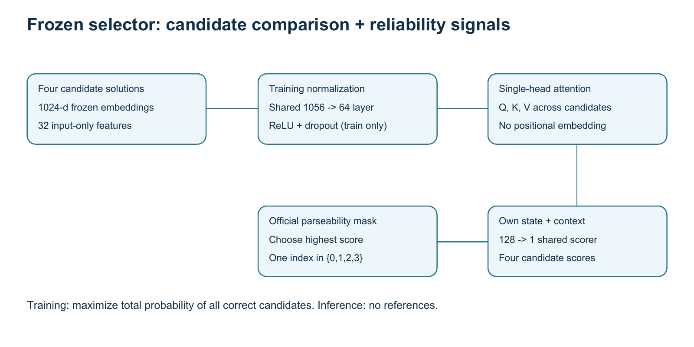

# DASE7506 MP2 - Selecting Reliable LLM Reasoning

**wuhaonan | 3036843288**  
Frozen method: compact candidate attention with reference-free format and arithmetic features. One model; NumPy-only CPU inference.

| Split | Correct | Accuracy |
|---|---:|---:|
| **Test (official submission metric)** | **381 / 467** | **81.5845824411135%** |
| Validation | 743 / 798 | 93.10776942355889% |
| Validation, distinct-answer subset | 300 / 355 | 84.51% |

**Inference assets:** 331,155 bytes = 0.316 MiB. **Complete test prediction + scoring:** 3.504 s locally, CPU four threads, AMD Ryzen 7 H 255. Reference-server eligibility remains determined by the instructor.

[English report (8 pages)](report/REPORT.pdf) | [Report source](report/REPORT.md) | [Official test JSON](evaluation/test-score.json) | [Checkpoint](model/) | [Release downloads](https://github.com/haonanwu869-rgb/DASE7506-MP2/releases/tag/v1.1) | [Experiment index](records/README.md) | [AI disclosure](AI_DISCLOSURE.md)

## Reproduce the score without retraining

Clone this project and the unchanged course data side by side. All commands below start from the parent directory:

```bash
git clone https://github.com/haonanwu869-rgb/DASE7506-MP2.git
git clone https://github.com/xudongwu-0/DASE7506-MP2.git course-data
cd DASE7506-MP2
python3.12 -m venv .venv
source .venv/bin/activate
python -m pip install -r requirements-inference.txt
python code/evaluate.py --data-dir ../course-data/code/data --split test
```

On Windows PowerShell, replace environment creation/activation with:

```powershell
py -3.12 -m venv .venv
.\.venv\Scripts\Activate.ps1
```

Expected official output: `"correct": 381`, `"n": 467`, `"accuracy": 81.5845824411135`. Use `--split validation` for 743/798. The wrapper sets thread limits before importing NumPy and runs prediction and scoring as separate fresh processes. Reproduction writes to evaluation/; timings may differ by machine.

## Method and findings

Each candidate combines 1,024 frozen embedding dimensions with 32 input-only features. A shared 64-dimensional projection and single-head set attention compare four candidates. Training maximizes total probability assigned to all correct candidates. The highest-scoring parseable candidate is returned. Inference never opens reference files and does not assume a fixed bank size or use IDs as lookup keys.



Three questions organize the [report](report/REPORT.pdf): whether joint scoring helps, whether explicit reliability features add value, and whether larger ensembles justify their cost. The final feature combination improves five-seed mean validation accuracy from 91.88% to 92.36%. Equal-weight ensembles do not outperform the primary single model. Validation and test have different answer-pattern mixtures; test results were not used for training, selection or tuning.

## Repository layout

```text
code/             final training, inference, unchanged official parser and scorer
model/            config.json and weights.npz; all inference assets
report/           English PDF, editable content, figure sources and generated figures
evaluation/       official validation/test predictions, scores and external timings
records/          indexed ablations, seed repetitions, ensembles and historical evidence
guide/            supplied assignment guide
attribution/      supplied GSM8K license and data notice
```

Data is obtained from the course repository, not duplicated here. Our frozen model is in `model/`; download only that directory or the model ZIP to obtain inference assets. Historical experiment records are not inference assets.

## Contents

- `code/submission.py`: required `predict(bank, arrays, checkpoint)` interface.
- `code/train.py`: standalone final-model training, reading the training split only.
- `code/evaluate.py`: sets four-thread limits before launching official prediction and scoring in separate fresh processes.
- `model/`: all inference assets, consisting of `config.json` and `weights.npz`.
- `report/REPORT.pdf`: eight-page English report; `REPORT.md`: editable English text; `content_en.json`: source for regenerating both.
- `evaluation/`: official validation and test predictions, scores and process timings from this package.
- `records/`: original experiment records, histories, environment information and development source snapshots. Some historical notes are retained in their original Chinese form. Historical absolute paths are not inference dependencies.
- `MODEL_MANIFEST.json`: inference-asset sizes and SHA256 hashes; `FILES_SHA256.json`: release-file checksums.
- `requirements-inference.txt` / `requirements-training.txt`: minimal inference / final-training dependencies.
- `requirements-experiments-lock.txt`: complete historical development environment.

## Data and installation

Use Python 3.12. The recorded platform is Windows 11 with an AMD Ryzen 7 H 255 CPU, restricted to four threads.
Use the unchanged full `code/data` directory from the coursework repository: https://github.com/xudongwu-0/DASE7506-MP2 . Data is not duplicated. Preserve its manifest, attribution and licenses; attribution copies are included in `attribution/`.

Inference needs only NumPy: no PyTorch, scikit-learn, LightGBM, API credentials, network connection or downloaded model weights are required at evaluation time.

From this package's root directory, run PowerShell:

```powershell
py -3.12 -m venv .venv
.\.venv\Scripts\python.exe -m pip install -r requirements-inference.txt
.\.venv\Scripts\python.exe code\evaluate.py --data-dir ..\course-data\code\data
```

If the package is moved, replace `--data-dir` with the actual course-data path. On Linux/macOS, use Python 3.12 and `.venv/bin/python` with the appropriate paths.

## Training reproduction

Labels and normalization statistics come from training data only. Final training uses five epochs over the full training split. The standalone entry point does not read validation or test data.
The epoch count was selected earlier using a fixed question-level internal training split of 3,804/951. Architecture and feature choices were compared on official validation. Evidence is retained in `records/`.

```powershell
.\.venv\Scripts\python.exe -m pip install -r requirements-training.txt
.\.venv\Scripts\python.exe code\train.py --data-dir ..\course-data\code\data --output retrained_model
.\.venv\Scripts\python.exe code\evaluate.py --data-dir ..\course-data\code\data --checkpoint retrained_model --output-dir evaluation_retrained
```

Training refuses to overwrite an existing output directory. Hardware and library differences may cause numerical variation. Use the frozen `model/` to reproduce this checkpoint directly.
The packaged inference path has been evaluated with the official validation and test scorers. The newly extracted minimal `train.py` has not been independently rerun; historical training outputs are retained.

## Editing the report and rebuilding the release

The English report is eight pages, below the ten-page limit. Edit `report/content_en.json`, then regenerate both PDF and Markdown:

```powershell
.\.venv\Scripts\python.exe -m pip install -r requirements-report.txt
.\.venv\Scripts\python.exe report\build_report.py
.\.venv\Scripts\python.exe make_release.py
```

Figures are generated with `python report/make_figures.py`; rasterize the figure PDFs to same-name PNGs with Poppler before rebuilding the report. Committed figure PNGs allow ordinary report rebuilding without Poppler. Standard PDF fonts are used; no Chinese font is required. Direct edits to `REPORT.md` do not automatically update the PDF. After any package change, run `make_release.py` to refresh checksums and the adjacent `final_submission.zip`.

## Completed final test evaluation

Completed on 26 October 2026 with the previously selected frozen model. Weight and configuration hashes are unchanged. Result: **381/467 (81.58%)**; total local time: **3.504 seconds** across the fresh prediction and scoring processes, with four threads. No training, selection or tuning used this test result. To reproduce:

```powershell
.\.venv\Scripts\python.exe code\evaluate.py --data-dir ..\course-data\code\data --split test
```

The report includes the official `evaluation/test-score.json` accuracy and `evaluation/test-timing.json`. Submit the test accuracy, not 93.11% validation accuracy. Local test timing is below the limit; final eligibility remains subject to the reference CPU. All test questions contain at least two distinct parseable answers; the corresponding validation subset scored 84.51%.
For an instructor audit bank, use `--split audit --data-dir <new-data-directory>`. Inference handles inputs dynamically without ID-based answer retrieval.

## Remaining submission tasks

1. Review the report, implementation, evidence and AI-assistance disclosure.
2. Preserve the frozen model and official test records; the test result is already included in the report and release checksums.
3. Use the repository tag `v1.1` and matching checkpoint download for submission; record the resolved Git commit SHA.
4. Complete the GitHub-issue submission through the course website. Publishing this repository does not submit the coursework form.

## AI assistance and reuse

Codex assisted with implementation, experiments, error reading and report preparation. The author should independently understand and review the work and disclose substantive assistance as required.
Only supplied data, frozen embeddings and official parsing/scoring tools were used. No external training data, additional pretrained weights or online LLM calls were used. Dependencies include NumPy and PyTorch; historical comparisons also used scikit-learn and LightGBM. No third-party algorithm repository code was directly copied.
Case-level error interpretations are AI-assisted readings, not instructor-confirmed labels, and are not training examples or inference lookup tables.

